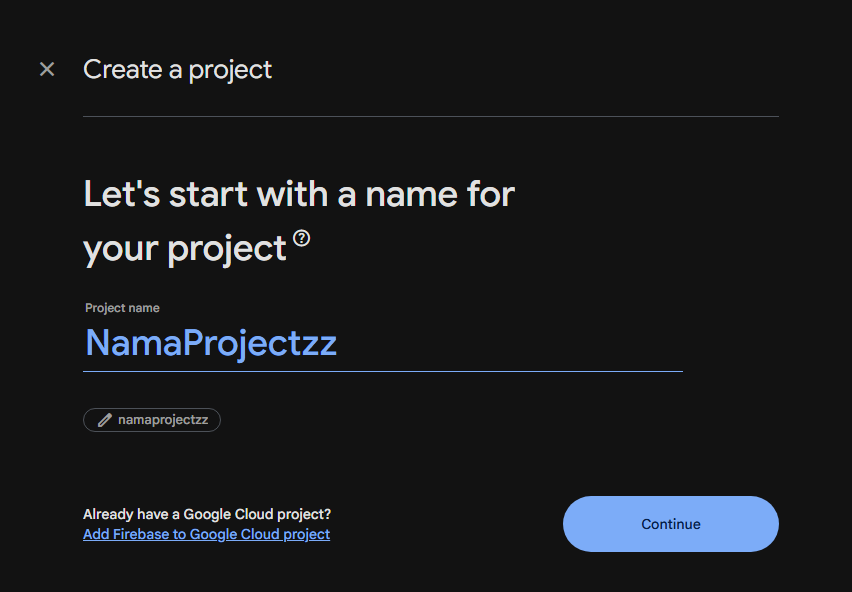
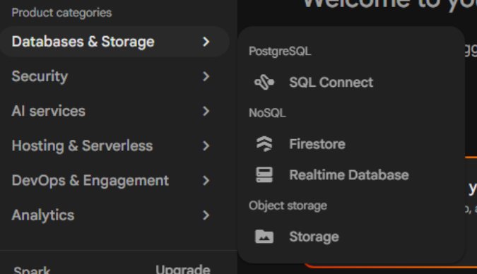
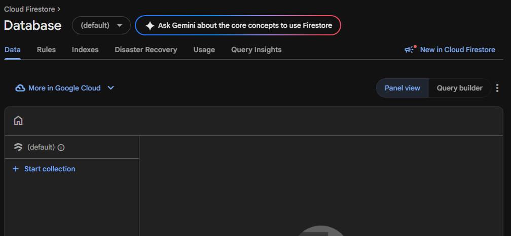
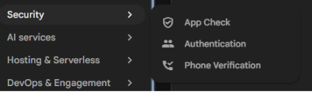
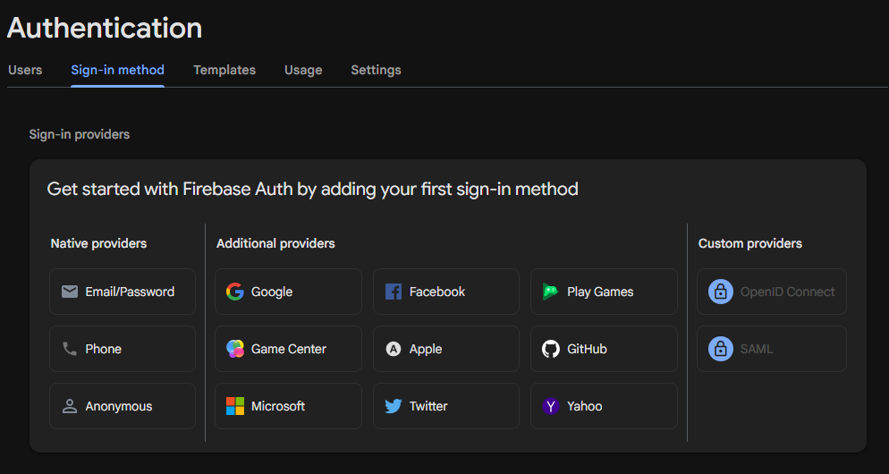
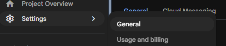
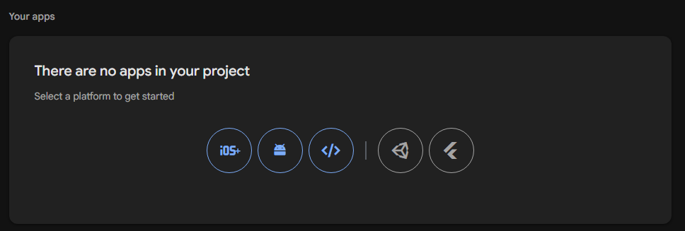
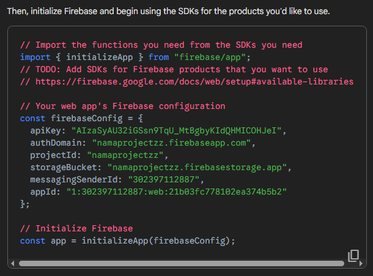
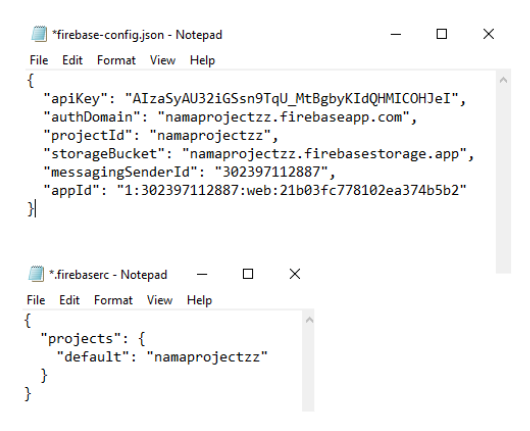

# Simpe Task Manager Prebuild

Panduan praktis langkah demi langkah untuk **pengguna biasa** (tanpa perlu paham pemrograman) agar dapat mendeploy website task manager sendiri secara gratis.

> Download file dan ikuti panduan dibawah

<p align="center">
  <a href="https://download-directory.github.io/?url=https://github.com/irfanhku/simple-taskmanager-prebuild/tree/main/EXTRACT_ME&filename=EXTRACT_ME" target="_blank">
    
  </a>
  &nbsp;
  <a href="https://github.com/firebase/firebase-tools/releases/latest/download/firebase-tools-instant-win.exe">
   
  </a>
</p>

---

# Panduan Deploy Website Task Manager ke Firebase Hosting (`.web.app`)

---

## 📌 Daftar Isi
1. [Tahap 0: Kebutuhan Awal (Prasyarat)](#tahap-0-kebutuhan-awal-prasyarat)
2. [Tahap 1: Membuat Project Firebase](#tahap-1-membuat-project-firebase)
3. [Tahap 2: Menyiapkan Database (Firestore)](#tahap-2-menyiapkan-database-firestore)
4. [Tahap 3: Menyiapkan Akun Login Admin](#tahap-3-menyiapkan-akun-login-admin)
5. [Tahap 4: Mengambil Kunci Konfigurasi Firebase](#tahap-4-mengambil-kunci-konfigurasi-firebase)
6. [Tahap 5: Memasang Konfigurasi ke Website](#tahap-5-memasang-konfigurasi-ke-website)
6. [Tahap 6: Deploy Website ke Internet](#tahap-6-deploy-website-ke-internet)
9. [🌐 Panduan: Cara Mengganti Nama Website Menjadi Nama Organisasi](#-panduan-cara-mengganti-nama-website-menjadi-nama-organisasi)
10. [Cara Menggunakan Website Setelah Aktif](#cara-menggunakan-website-setelah-aktif)
11. [Troubleshooting (Tanya Jawab & Kendala Umum)](#troubleshooting-tanya-jawab--kendala-umum)

---

## Tahap 0: Kebutuhan Awal (Prasyarat)

Sebelum memulai, siapkan 3 hal berikut di komputer/laptop Anda:

1. **Akun Google**: Untuk login ke [Firebase Console](https://console.firebase.google.com/) (100% Gratis di paket Spark).
2. **Firebase CLI**: Download file dari tombol diatas atau [klik sini](https://github.com/firebase/firebase-tools/releases/latest/download/firebase-tools-instant-win.exe).
3. **Donwload `EXTRACT_ME`**: Downlaod file dari tombol diatas atau [klik disini](https://download-directory.github.io/?url=https://github.com/irfanhku/simple-taskmanager-prebuild/tree/main/EXTRACT_ME&filename=EXTRACT_ME).

Setelah ketiga hal diatas sudah ada, lanjutkan proses dibawah ini:

#### **A. Ekstrak dan Susun Folder Website**

Setelah mengunduh `EXTRACT_ME` dan Firebase CLI, ekstrak terlebih dahulu sehingga dapat `FOLDER_WEB`. Kemudian, pindahkan file Firebase CLI yang bernama seperti `firebase-tools-instant-win.exe` ke dalam direktori utama `FOLDER_WEB`.

Pastikan struktur folder Anda sudah sesuai dengan susunan berikut:

```
FOLDER_WEB/
 ├── dist/
 │   ├── assets/
 │   │   ├── index-...js
 │   │   └── index-...css
 │   ├── favicon.svg
 │   ├── firebase-config.json
 │   └── index.html
 ├── .firebaserc
 ├── firebase.json
 ├── firestore.rules
 └── firebase-tools-instant-win.exe -> pindahkan file ini ke dalam FOLDER_WEB
```

**Penting:** File `firebase-tools-instant-win.exe` harus berada di direktori utama `FOLDER_WEB`, sejajar dengan file `firebase.json`, bukan di dalam folder `dist`.

#### **B. Mengganti Logo Website (Favicon)**

Secara default, website menggunakan file `favicon.svg` sebagai logo yang ditampilkan pada tab browser. Anda dapat menggantinya dengan logo organisasi, perusahaan, sekolah, komunitas, atau identitas lainnya.

Ikuti langkah-langkah berikut untuk mengganti logo:

1. **Siapkan file logo Anda.** Gunakan gambar yang jelas dan mudah dikenali dalam ukuran kecil. Format yang dapat digunakan antara lain `.svg`, `.png`, `.ico`, atau `.jpg`. Untuk hasil terbaik, gunakan logo berbentuk persegi dengan latar belakang transparan jika memungkinkan.
2. **Buka folder** **`dist`** **.** Letakkan file logo Anda di dalam folder tersebut, yaitu di direktori yang sama dengan `index.html`.
3. **Delete file `favicon.svg` awal dan ganti nama file logo anda menjadi** **`favicon`** **.** Sesuaikan nama file dengan format gambar yang digunakan. Contohnya:
   - `favicon.svg` untuk logo SVG.
   - `favicon.png` untuk logo PNG.
   - `favicon.ico` untuk logo ICO.
   - `favicon.jpg` untuk logo JPG.
4. **Jika logo Anda bukan file dengan tipe `.svg`, ikuti langkah 5-7 ini:** 
6. **Perbarui referensi `favicon.svg` pada** **`index.html`** **.** Buka file `dist/index.html` menggunakan teks editor, seperti Visual Studio Code atau Notepad. Cari baris yang berisi referensi logo, lalu sesuaikan dengan nama dan format file logo Anda. 
   
   Update file `index.html` baris ke-6, yang awalnya seperti ini: 
   ```html
   <link rel="icon" type="image/svg+xml" href="/favicon.svg" />
   ```
   Jika menggunakan logo PNG, ubah menjadi:
   ```html
   <link rel="icon" type="image/png" href="/favicon.png" />
   ```
   Jika menggunakan logo ICO, ubah menjadi:
   ```html
   <link rel="icon" type="image/x-icon" href="/favicon.ico" />
   ```
   Jika menggunakan logo JPG, ubah menjadi:
   ```html
   <link rel="icon" type="image/jpeg" href="/favicon.jpg" />
   ```
6. Perbarui juga `index.html` baris ke-25, yang terlihat seperti ini:
   ```html
   
   ```
   Ganti menjadi:
   ```html
   
   ```
   Atau sesuaikan dengan format file logo yang Anda gunakan, baik itu `favicon.png`, `favicon.ico`, dan lainnya.
7. **Simpan perubahan dan periksa kembali file Anda.** Pastikan nama file, ekstensi, atribut `type` sudah sesuai. File logo juga harus berada di dalam folder `dist`, bukan di direktori utama `FOLDER_WEB`.

**Catatan penting:**

- Jangan hanya mengganti nama file tanpa memperhatikan format aslinya. Misalnya, mengganti `logo.png` menjadi `favicon.svg` tidak mengubah format PNG menjadi SVG.
- Pastikan logo memiliki kontras yang cukup dan tetap terlihat jelas ketika ditampilkan dalam ukuran kecil pada tab browser.

## 3\. Mengganti Nama Website dan Judul Halaman

Jika Anda ingin mengganti tulisan **Simple Task Manager** menjadi nama organisasi Anda, lakukan langkah berikut.

1. Buka file `dist/index.html` menggunakan teks editor.
2. Cari baris ke-15 yang berisi judul halaman berikut:
   ```html
   <title>Simple Task Manager</title>
   ```
   Ganti teks tersebut dengan nama organisasi Anda. Contohnya:
   ```html
   <title>Organisasi ABC</title>
   ```
   Teks ini biasanya ditampilkan pada judul tab browser.
3. Cari bagian halaman baris ke-28 yang menampilkan nama website:
   ```html
   ...
   <div>
     Simple Task Manager
   </div>
   ...
   ```
   Ganti teks `Simple Task Manager` dengan nama organisasi Anda, misalnya:
   ```html
   ...
   <div>
     Organisasi ABC
   </div>
   ...
   ```
   Perubahan ini akan mengganti tulisan yang ditampilkan pada bagian website yang menggunakan elemen tersebut.
4. Simpan perubahan pada `index.html`, kemudian periksa website untuk memastikan nama baru sudah tampil dengan benar.

**Catatan:** Nomor baris dapat berbeda tergantung versi file yang Anda gunakan. Jika teks tidak ditemukan pada baris yang disebutkan, gunakan fitur pencarian teks pada editor untuk mencari `Simple Task Manager`.

Pastikan seluruh perubahan sudah disimpan sebelum melanjutkan ke proses deployment website menggunakan Firebase CLI.


---

## Tahap 1: Membuat Project Firebase

1. Buka browser dan kunjungi **[Firebase Console](https://console.firebase.google.com/)**.
2. Klik tombol **"Create a new Firebase Project"** (atau "Get started by setting up Firebase project").
3. Masukkan nama project Anda (misal: `task-organisasi-kami`).
   > 💡 **PENTING UNTUK NAMA WEBSITE:**  
   > Di bawah kolom nama, Anda akan melihat **Project ID** (contoh: `task-organisasi-kami-abc12` -> *case sensitive*) . Klik ikon pensil untuk mengubah Project ID ini sesuai keinginan Anda, karena Project ID inilah yang akan menjadi alamat website Anda nantinya (`https://<project-id>.web.app`).
 


4. Klik **Continue**.
5. Pada pilihan *Gemini in Firebase* dan *Google Analytics*, matikan/uncheck jika tidak dibutuhkan (opsional), lalu klik **Create project**.
6. Tunggu beberapa detik hingga selesai, lalu klik **Continue**.

---

## Tahap 2: Menyiapkan Database (Firestore)

Database digunakan untuk menyimpan tugas, catatan jadwal, dan kalender secara online dan realtime.

1. Pada menu dashboard Firebase di sebelah kiri, klik menu **Database & Storage** > NoSQL > **Firestore**.
2. Klik tombol **Create database**.



3. Pilih `Standard Edition` dan Next.
4. Pada pilihan lokasi database (*Location*), pilih **`asia-southeast2 (Jakarta)`** (atau lokasi terdekat dengan Anda) agar loading cepat. Klik **Next**.
4. Pada pilihan aturan keamanan (*Security rules*), pilih **Start in production mode**. (Aturan keamanan nanti akan otomatis diatur oleh file `firestore.rules` dari folder proyek ini).
5. Klik **Create** dan tunggu proses inisialisasi selesai.



---

## Tahap 3: Menyiapkan Akun Login Admin

Aplikasi ini mengizinkan semua orang melihat jadwal tugas (publik), namun **hanya akun terdaftar** yang dapat menambah, mengubah, atau menghapus tugas.

1. Di menu sidebar kiri Firebase, klik **Security** > **Authentication**.
2. Klik tombol **Get started**.

`

3. Di tab **Sign-in method**, pilih penyedia **Email/Password**.
4. Hanya aktifkan sakelar pertama yaitu `Email/Password enable`, lalu klik **Save**.



5. Pindah ke tab **Users** (di sebelah tab Sign-in method).
6. Klik tombol **Add user**.
7. Masukkan email dan kata sandi yang ingin Anda gunakan sebagai akun Admin/Pengelola.
8. Klik **Add user**. Simpan email dan kata sandi tersebut baik-baik.


---

## Tahap 4: Mengambil Kunci Konfigurasi Firebase

Kunci konfigurasi ini diperlukan agar website dapat terhubung ke database Firebase Anda.

1. Di Firebase Console, klik ikon **Gerigi (Project settings ⚙️)** di sudut kiri atas menu sidebar.
2. Di tab **General**, gulir layar ke bawah ke bagian **Your apps**.
3. Klik ikon web: **`</>`**.
  




4. Masukkan nama aplikasi (bebas, misal: `Web Task Manager`), centang/lewati pilihan Firebase Hosting, lalu klik **Register app**.
5. Di bagian script yang muncul, perhatikan kode konfigurasi yang berada di dalam `firebaseConfig`:



> **Note:** Kunci ini merupakan kode proyek publik. Siapa pun yang memiliki kunci tersebut hanya dapat melihat data, tanpa bisa mengubahnya. Karena data ini memang ditujukan untuk disebarkan ke publik, ini sudah sesuai dengan yang diharapkan (_works as intended_).

Biarkan halaman ini tetap terbuka untuk menyalin nilainya ke tahap berikutnya.

---

## Tahap 5: Memasang Konfigurasi ke Website

Buka folder proyek ini di komputer Anda menggunakan teks editor (seperti Notepad, VS Code, atau aplikasi teks lainnya):

### 1. Buka file `dist/firebase-config.json`
Ganti nilai placeholder dengan kode yang Anda peroleh dari **Tahap 4**:

```json
{
  "apiKey": "PASTE_API_KEY_ANDA_DI_SINI",
  "authDomain": "PROJECT_ID_ANDA.firebaseapp.com",
  "projectId": "PROJECT_ID_ANDA",
  "storageBucket": "PROJECT_ID_ANDA.firebasestorage.app",
  "messagingSenderId": "PASTE_MESSAGING_SENDER_ID_DI_SINI",
  "appId": "PASTE_APP_ID_DI_SINI"
}
```
*Simpan file (`Ctrl + S`).*

### 2. Buka file `.firebaserc`
Buka file `.firebaserc` di folder utama dan ganti nama project:

```json
{
  "projects": {
    "default": "PROJECT_ID_ANDA"
  }
}
```
*Ganti `PROJECT_ID_ANDA` dengan ID project yang Anda buat di Tahap 1.*



*Simpan file (`Ctrl + S`).*

---

## Tahap 6: Deploy Website ke Internet

Website ini sudah di-compile dan siap pakai (*prebuilt*). Anda **tidak perlu menjalankan build apa pun**.

1. Buka file `firebase-tools-instant-win.exe` yang tadi sudah didownload dan simpan di `FOLDER_WEB`.

2. Lalu ada pilihan (Yes/No) untuk Gemini dan Collect data, pilih sesuai yang Anda inginkan.
3. *Kemudian, browser akan terbuka otomatis. Masuk dengan akun Google/Firebase yang Anda gunakan di Tahap 1, Jika ada pop-up klik **Allow**.*

4. Tunggu beberapa detik untuk login, hingga terminal akan menampilkan pesan:
   ```text
   Waiting for authentication...

   +  Success! Logged in as <youremail>@gmail.com

   + You can now use the 'firebase' or 'npm' commands!
   ~ For more help see https://firebase.google.com/docs/cli/
   ```

4. Setelah berhasil login, jalankan perintah deploy:
   ```bash
   firebase deploy
   ```

5. Tunggu beberapa detik hingga proses selesai. Terminal akan menampilkan pesan:
   ```text
   ✔  Deploy complete!

   Hosting URL: https://PROJECT_ID_ANDA.web.app
   ```

🎉 **Selamat! Website Anda sudah online dan dapat diakses siapa saja melalui link `https://PROJECT_ID_ANDA.web.app`!**

---

## 🌐 Panduan: Cara Mengganti Nama Website Menjadi Nama Organisasi

Banyak pengguna bertanya: ***Apakah alamat website `.web.app` bisa diganti menjadi nama organisasi yang diinginkan?***

### 🟢 Jawabannya: **BISA!**
Firebase Hosting menyediakan beberapa opsi fleksibel:

---

### Opsi A: Menentukan Nama Sejak Awal Pembuatan Project [Mudah dan Tidak Berbayar]
*Format URL:* `https://nama-organisasi.web.app`

1. Saat Anda membuat project baru di Firebase Console (Tahap 1), Firebase membuat *Project ID* otomatis.
2. Klik ikon pensil pada kolom **Project ID**.
3. Ketikkan nama organisasi yang Anda inginkan (misal: `himpunan-informatika`, `osis-negeri1`, dsb.).
4. Jika nama tersebut masih tersedia di seluruh dunia, website Anda akan langsung beralamat di:
   - `https://nama-organisasi.web.app`
   - `https://nama-organisasi.firebaseapp.com`

---

### Opsi B: Menggunakan Domain Organisasi Sendiri [Berbayar] (Contoh: `organisasi.com` atau `task.organisasi.id`)
Jika organisasi Anda memiliki domain web resmi sendiri, Anda bisa menghubungkannya ke Firebase Hosting secara **100% gratis** (termasuk sertifikat keamanan HTTPS/SSL otomatis), namun persyaratan ini harus mempunyai domain dulu dari pihak lain yang terkadang perlu biaya tambahan untuk domain.

1. Buka **Firebase Console** > **Build** > **Hosting**.
2. Klik tombol **"Add custom domain"** (Tambahkan domain khusus).
3. Masukkan nama domain atau subdomain Anda (contoh: `tugas.sekolahkami.sch.id` atau `organisasi.com`).
4. Firebase akan menampilkan catatan DNS (berupa *A Record* atau *TXT/CNAME*).
5. Masuk ke penyedia tempat Anda membeli domain (misal: Cloudflare, Niagahoster, Domainesia, Namecheap, dsb.), lalu tempelkan catatan DNS yang diberikan oleh Firebase.
6. Klik **Verify**. Dalam waktu 10 menit hingga beberapa jam, website Anda dapat diakses menggunakan alamat resmi organisasi tersebut!

---

## Cara Menggunakan Website Setelah Aktif

1. **Akses Publik (Melihat Saja):**
   - Bagikan link `https://PROJECT_ID_ANDA.web.app` kepada anggota tim, guru, peserta, atau siapa saja.
   - Semua orang dapat melihat papan Kanban, kalender kegiatan, dan tabel jadwal mingguan secara langsung tanpa perlu login.
   - Siapa pun juga dapat menekan tombol **Print / Simpan PDF** untuk mengunduh laporan jadwal yang bersih.

2. **Akses Pengelola (Membuat & Mengedit Tugas):**
   - Di sudut kanan atas website, klik tombol **Login**.
   - Masukkan email dan password Admin yang sudah Anda daftarkan pada **Tahap 3**.
   - Setelah login, tombol **+ Tambah Task**, fitur *drag-and-drop*, opsi edit, dan tombol hapus akan otomatis aktif.
   - Jika sudah selesai mengedit, Anda bisa menekan tombol **Logout**.

---

## Troubleshooting (Tanya Jawab & Kendala Umum)

**T: Muncul pesan error "Missing or insufficient permissions" saat login atau membuat tugas?**  
> **Jawab:** Pastikan aturan database sudah ter-deploy. Anda bisa menjalankan perintah ini di terminal:
> ```bash
> firebase deploy --only firestore:rules
> ```
> Pastikan juga Anda sudah login menggunakan email & password yang dibuat di Firebase Authentication.

**T: Halaman website berisi kosong (blank screen)?**  
> **Jawab:** Periksa file `dist/firebase-config.json`. Pastikan semua nilai kunci (*API key*, *Project ID*, dll.) terisi dengan benar dan tanda kutip ganda `""` serta koma `,` tidak ada yang terhapus secara tidak sengaja.

**T: Lupa kata sandi Admin?**  
> **Jawab:** Buka Firebase Console > **Authentication** > tab **Users**. Cari email akun Anda, klik ikon titik tiga di sebelah kanan, lalu pilih **Reset password** atau **Change password**.

**T: Apakah layanan ini gratis selamanya?**  
> **Jawab:** Ya. Paket **Firebase Spark Plan (Gratis)** mencukupi kebutuhan task manager organisasi dengan batas hingga 50.000 kali pembacaan data per hari dan penyimpanan 1 GB, tanpa perlu memasukkan kartu kredit.

---

## Lisensi

Proyek ini menggunakan lisensi **GNU General Public License v3.0 (GPL-3.0)**. Anda bebas menggunakan, memodifikasi, dan mendeploy website ini untuk kebutuhan pribadi maupun organisasi Anda.
